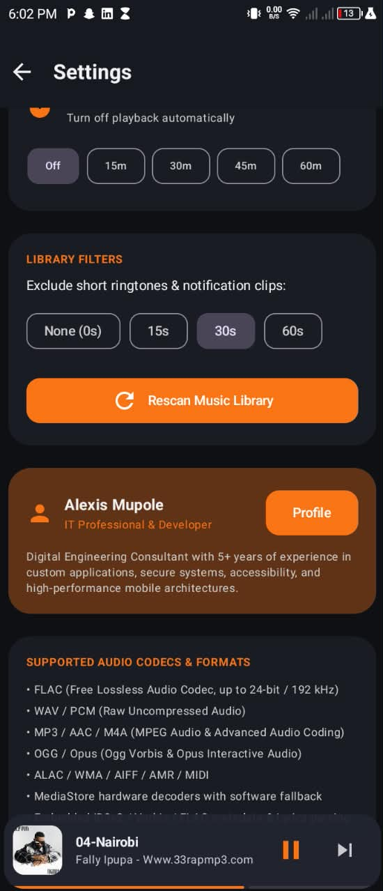
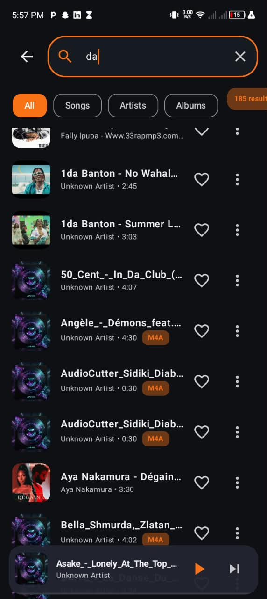
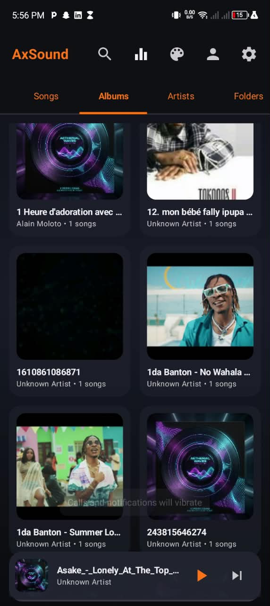
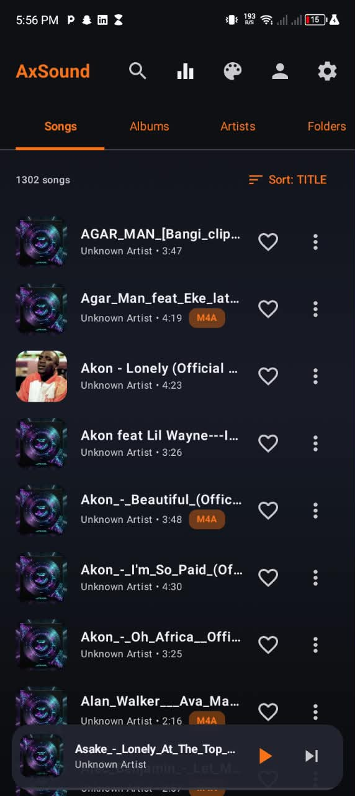

# AxSound 🎵

**English | [Français](README.fr.md)**

[](https://developer.android.com)
[](https://kotlinlang.org)
[](https://developer.android.com/about/dashboards)
[](https://developer.android.com)
[](LICENSE.md)

**AxSound** is an offline high-fidelity music player for Android, designed to deliver uncompromised sound purity, a powerhouse volume boost of up to 400%, deep visual customization and minimal battery drain thanks to hardware DSP decoding (*Audio Offload*).

---

## ⬇️ Download

[](https://github.com/Alexis-Mupole/AxSound/raw/main/AxSound.apk)

> **Safe and verifiable**: this APK is built from the open-source code published in this repository — no malicious code, no ads, no tracking and no data collection. You are free to inspect it, rebuild it yourself and compare the binaries.
>
> **SHA-256 fingerprint** of `AxSound.apk`:
> ```
> 94d575f59c2f51a8ed184780612356a23242e16d680a2e74ed073b959fa70df6
> ```
>
> Verification: `certutil -hashfile AxSound.apk SHA256` (Windows) or `sha256sum AxSound.apk` (Linux/macOS).

---

## 📸 Screenshots

<table>
  <tr>
    <td align="center"></td>
    <td align="center"></td>
    <td align="center"></td>
  </tr>
  <tr>
    <td align="center"></td>
    <td align="center"></td>
    <td></td>
  </tr>
</table>

---

## 🌟 Key Features

### 🔊 Max Volume Engine (Up to 400% — Louder than VLC)
- **Safe hardware amplification**: uses `android.media.audiofx.LoudnessEnhancer` wired directly to the ExoPlayer audio session.
- **Built-in brickwall limiter**: on Android 9+ (API 28+), a `DynamicsProcessing` limiter (-0.5 dBFS, 1 ms attack, 50 ms release) protects the speakers from digital clipping.
- **Per-output profiles**: distinct boost levels are remembered for Speaker, Wired Headset and Bluetooth.
- **Hearing protection warning**: an explicit alert before crossing the 200% (+6 dB) threshold.

### 🔋 Power Efficiency & Eco Mode (DSP Audio Offload)
- **Direct DSP decoding**: in *Efficiency Mode*, decoding runs on the low-power DSP (`AudioOffloadPreferences`), letting the main CPU stay in deep sleep (~1.8% battery/hour with the screen off).
- **Smart WakeLock handling**: `setWakeMode(C.WAKE_MODE_LOCAL)` guarantees no wake lock is held outside of playback.
- **Automatic resource release**: full shutdown and effects release after 10 minutes of inactivity.
- **Optimized refresh rate**: spectrum visualizer capped at 30 fps and progress bar at 1 Hz, both stopped completely when the screen is off.

### 🎨 Deep Visual Customization
- **Display modes**: Light, Dark, System and **Pure Black AMOLED** (`#000000`).
- **16+ accent colors** plus a custom HEX/HSV picker.
- **Immersive gradients**: Midnight, Cyberpunk, Sunset, Ocean, Aurora, Forest, Rose and Electric presets.
- **Dynamic theming**: Material You (system wallpaper) support and adaptive album-art color extraction (*Palette API*).
- **Theme Import / Export** as JSON without restarting the app.

### 🎧 Audio Formats & Playback Engine
- **Universal support**: MP3, AAC, M4A, FLAC, WAV, OGG, Opus, AMR, MIDI, MKA, 3GP, AIFF, WMA and ALAC.
- **Hi-Res badges**: automatic detection of high-resolution streams (e.g. `HI-RES • FLAC • 24-bit • 96 kHz`).
- **Lyrics support**: synced lyrics from `.lrc` files or embedded tags.
- **Robustness**: transparent recovery and automatic skip without a crash on damaged or corrupted files.
- **Graphic equalizer**: 5 bands, Bass Boost, Virtualizer and studio presets.

---

## 🏗️ Architecture & Technologies

AxSound follows **Clean Architecture** principles and the **MVVM** pattern:

- **Language**: Kotlin
- **UI**: Jetpack Compose + Material Design 3
- **Audio engine**: AndroidX Media3 (ExoPlayer + `MediaSessionService`)
- **Local persistence**: Room database (favorites, playlists, history, metadata cache and ReplayGain)
- **Preferences**: Jetpack DataStore Preferences
- **Image loading**: Coil (with memory & disk caching and strict resizing)
- **Navigation**: Navigation Compose with smooth transitions

---

## 🚀 Building & Local Development

### Prerequisites
- **Android Studio** Ladybug (2024.2+) or newer
- **JDK**: version 17 or 21
- **Android SDK**: Compile SDK 36, Target SDK 35, Min SDK 26

### Clone and build

```bash
# Clone the repository
git clone https://github.com/Alexis-Mupole/AxSound.git
cd AxSound

# Build the project in Debug mode
gradle assembleDebug

# Run the unit and Robolectric test suites
gradle testDebugUnitTest
```

The generated APK will be located at: `app/build/outputs/apk/debug/app-debug.apk`.

---

## 🤝 Contributing

Contributions are welcome! To suggest an improvement, fix a bug or submit a translation:
1. Read our contribution guide: [CONTRIBUTING.md](CONTRIBUTING.md).
2. Follow our code of conduct: [CODE_OF_CONDUCT.md](CODE_OF_CONDUCT.md).

---

## 📄 License

This project is released under the open-source **Apache 2.0** license. See [LICENSE.md](LICENSE.md) for details.
